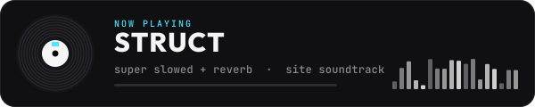

<!-- ───────────────────────────────────────────────────────────────
  Profile README: this repo is Ahmadhussain0033/Ahmadhussain0033, so GitHub
  shows this file on the profile page. The same repo serves the site on Pages.

  The cards (player / medals / hexoro / support) are generated from js/config.js
  + live stats by tools/readme_cards.py and refreshed by the "readme stats"
  Action, so edit config.js and the README follows. Site docs live in SETUP.md.
──────────────────────────────────────────────────────────────── -->

<p align="center">
  <a href="https://ahmadhussain0033.github.io/Ahmadhussain0033/">
    
  </a>
</p>

<p align="center">
  <a href="https://ahmadhussain0033.github.io/Ahmadhussain0033/"></a>
</p>

<p align="center">
  <a href="https://ahmadhussain0033.github.io/Ahmadhussain0033/"></a>
  <a href="https://discord.com"></a>
  <a href="https://ahmadhussain0033.github.io/Ledger/#donate"></a>
  <a href="https://github.com/Hexoro"></a>
</p>

<!-- ─────────────── player card ─────────────── -->
<p align="center">
  <a href="https://ahmadhussain0033.github.io/Ahmadhussain0033/#about">
    
  </a>
</p>

<!-- ─────────────── medals + hexoro ─────────────── -->
<p align="center">
  <a href="https://ahmadhussain0033.github.io/Ahmadhussain0033/#achievements"></a>
  <a href="https://ahmadhussain0033.github.io/Ahmadhussain0033/hexoro/"></a>
</p>

<!-- ─────────────── support ─────────────── -->
<p align="center">
  <a href="https://ahmadhussain0033.github.io/Ledger/">
    
  </a>
</p>


<!-- ─────────────── activity ─────────────── -->
<p align="center">
  
  <a href="https://ahmadhussain0033.github.io/Ahmadhussain0033/#media"></a>
</p>
<p align="center">
  
</p>

<!-- ─────────────── your thoughts ───────────────
  When you're ready, delete this comment line and the closing one below, and write
  your take on information theory between them. It renders as a quote block.

> ### `~/thoughts.md`
> your words here.

──────────────────────────────────────────────── -->

<details>
<summary><b><code>$ cat whoami.py</code></b></summary>
<br>

```python
class Ahmad:
    handle    = "nerdatronic"
    org       = "Hexoro"            # github.com/Hexoro
    roles     = ["aspiring information theorist", "researcher", "a bit of everything"]
    thinking  = ["information theory", "research"]
    listening = "STRUCT — super slowed + reverb"
    motto     = "Nothing matters so everything matters equally"
    site      = "https://ahmadhussain0033.github.io/Ahmadhussain0033/"
```

</details>

<details>
<summary><b><code>$ ./contact.sh</code></b></summary>
<br>

| | |
|---|---|
| **discord** | `nerdatronic` |
| **site** | [ahmadhussain0033.github.io/Ahmadhussain0033](https://ahmadhussain0033.github.io/Ahmadhussain0033/#contact) |
| **guestbook** | [sign the wall](https://ahmadhussain0033.github.io/Ahmadhussain0033/#guestbook) |
| **hexoro** | [the Hexoro page](https://ahmadhussain0033.github.io/Ahmadhussain0033/hexoro/) |
| **support** | [the ledger](https://ahmadhussain0033.github.io/Ledger/#donate) |

</details>


<p align="center"><sub><code>/</code> opens the menu on my site · <code>m</code> plays the music · <code>f</code> shows the fps · type anything for the sounds</sub></p>
